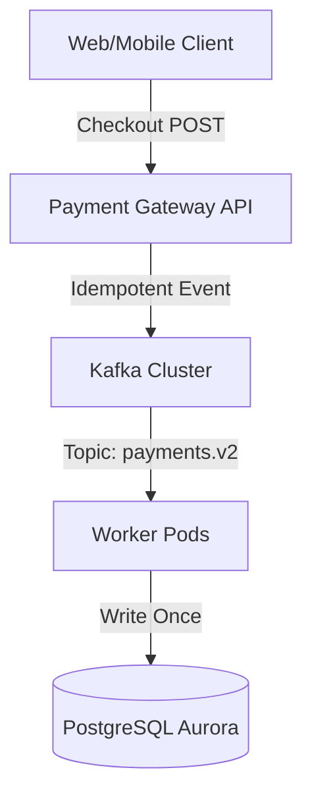

# Payment Gateway v2 Migration & LLM Execution Spec

> **Document Status**: `REVIEW`
> **Version**: 2.1.0
> **Author**: `agent-architect` & `human-reviewer`
> **Target Release**: Q1 2027

---

## 1. Executive Summary & Review Verdict

> [!APPROVED] Reviewed by human on 2026-11-10 09:30

This document defines the zero-downtime migration strategy for switching legacy Stripe webhook ingestion to the unified event-driven payment hub.

Certainly! Here is the implementation plan for the requested feature:
Without further ado, let's dive into the core architecture of the service.
In this section we will discuss the primary event loop.

- [x] Draft initial RFC architecture
- [x] Secure API credentials with Vault
- [/] Benchmark webhook consumer throughput
- [?] Should we maintain backward-compatibility with v1 signature headers?

---

## 2. Architecture & Decision Records

> [!DECISION]
> We adopt asynchronous Kafka consumers with idempotency keys rather than synchronous HTTP dispatch to ensure resilience during network partitions.

> [!AGENT]
> @agent: Keep error response formats conforming strictly to RFC 7807 Problem Details.



---

## 3. Acceptance Criteria & BDD Test Scenarios

### Scenario: Idempotent Payment Charge
- Given an existing customer with ID `cust_9921`
- And a valid non-expired authorization token
- When a `POST /v2/charges` request arrives with `Idempotency-Key: idemp_abc123`
- Then the charge is processed exactly once
- And the HTTP status code is `200 OK`
- And subsequent retries with the same key return the cached charge result

**AC-01**: Gateway must reject replayed nonces within 24 hours.
**AC-02**: Latency must strictly meet p99 < 80ms SLO under 5,000 req/sec load.

---

## 4. Critical Hazards, Security & Database Operations

> [!SECURITY]
> All webhook payload secrets and HMAC signatures must be validated in constant time to prevent side-channel timing attacks.

> [!BREAKING]
> Deprecated endpoint `POST /v1/charge_direct` will be permanently disabled in release v2.2.0.

> [!WARNING]
> Database migration steps below require strict peer approval before production execution.

```bash
# Emergency rollback command in case of data corruption:
rm -rf /var/lib/payment-cache/*
```

```sql
-- DANGER: Schema modification
ALTER TABLE payment_records ADD COLUMN idempotency_hash VARCHAR(64) NOT NULL;
```

---

## 5. Implementation Task Tracker & Traceability

- `@impl: lua/super-markdown/init.lua`
- `@test: tests/run_all.lua`
- [x] REQ-01: HMAC-SHA256 signature verification filter
- [x] REQ-02: Exponential backoff retry handler (1s, 2s, 4s, max 5 attempts)
- [ ] REQ-03: Dead-letter queue (DLQ) automated replay worker
- [!] Fix timing side-channel vulnerability in HMAC comparison

> [!REVIEW] @human: Ensure DLQ replay rate is throttled to avoid cascading overload.
