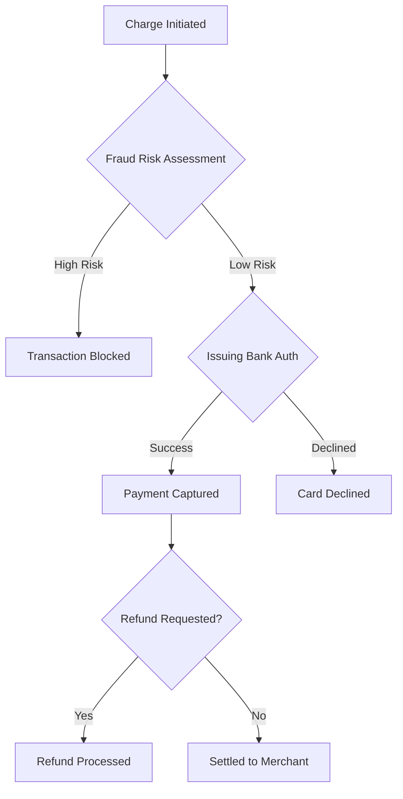

# Payment Gateway API Reference

> [!NOTE]
> All timestamps in requests and responses are ISO 8601 UTC strings (`YYYY-MM-DDTHH:MM:SSZ`).

---

## 1. Authentication

Every API call requires a valid Bearer token passed in the `Authorization` header:

```bash
curl -X GET "https://api.payments.io/v1/charges" \
  -H "Authorization: Bearer sec_live_9a8b7c6d5e" \
  -H "Content-Type: application/json"
```

---

## 2. Charge Processing State Machine



---

## 3. Endpoints Matrix (Unaligned Table Sample)

Here is an unaligned table before formatting with `<leader>mtf`:

|Method|Path|Description|Auth Required|Rate Limit|
|:---|:---|:---|:---:|---:|
|POST|/v1/charges|Create a new payment charge|Yes|100 req/min|
|GET|/v1/charges/:id|Retrieve charge status|Yes|500 req/min|
|POST|/v1/refunds|Issue full or partial refund|Yes|50 req/min|
|GET|/v1/health|Public system health check|No|Unlimited|

---

## 4. Response Schemas

### Successful Charge Response (`201 Created`)

```json
{
  "id": "ch_3Mv6c7LkdIwHu7ix0H2B3e4a",
  "object": "charge",
  "amount": 2000,
  "currency": "usd",
  "status": "succeeded",
  "customer": "cus_9s8d7f6e5a",
  "created_at": "2026-10-18T02:30:00Z"
}
```

---

## 5. Client Integration Example

```python
import httpx

def create_charge(amount_cents: int, currency: str = "usd") -> dict:
    client = httpx.Client(base_url="https://api.payments.io/v1")
    response = client.post(
        "/charges",
        headers={"Authorization": "Bearer sec_live_test"},
        json={"amount": amount_cents, "currency": currency},
    )
    response.raise_for_status()
    return response.json()
```

---

## 6. Verification Tasks

- [x] Verify TLS 1.3 cipher suite configuration
- [/] Benchmark API response times against SLO targets
- [ ] Implement webhook retry with exponential backoff
- [?] Should webhook callbacks include signed HMAC-SHA256 headers?
