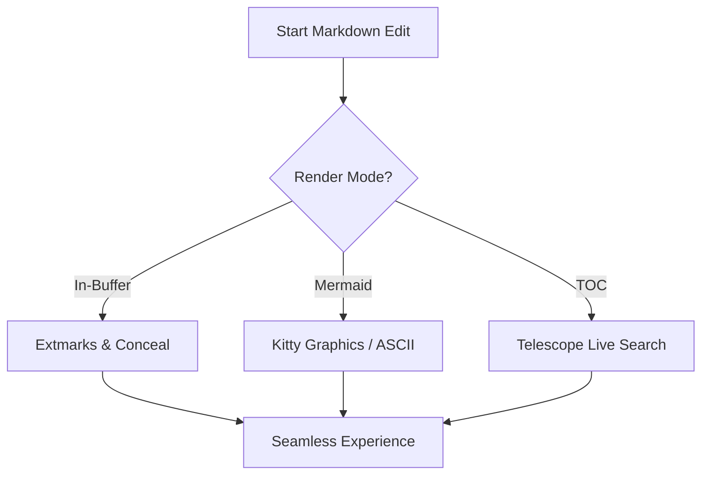
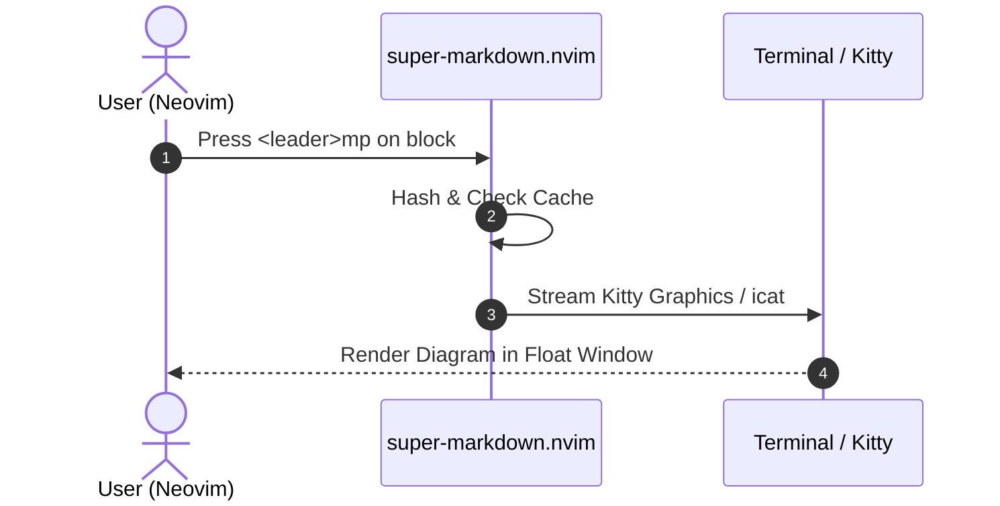

# SuperMarkdown Showcase

Welcome to **super-markdown.nvim**! This document demonstrates all features of the plugin in action.

---

## 1. Checklists & Task Management

Interactive checkboxes that can be toggled using `<leader>mx`:

- [ ] Unchecked task (press `<leader>mx` to check)
- [x] Completed task with green checkmark
- [-] Canceled or postponed task
- [/] Task currently in progress
- [!] Urgent / high-priority item
- [?] Open question needing investigation

---

## 2. GitHub & Obsidian Callouts

> [!NOTE]
> This is an informative callout note. Notice the styled vertical bar and icon.

> [!TIP]
> You can preview any Mermaid diagram by placing your cursor inside the block and pressing `<leader>mp`.

> [!IMPORTANT]
> The TOC viewer seamlessly integrates with Telescope or Snacks to let you jump anywhere instantly.

> [!WARNING]
> In-buffer rendering makes reading documents a joy without needing an external browser!

> [!CAUTION]
> Always verify database migrations before running them in production environments.

> [!TODO]
> Implement automatic image paste directly from system clipboard.

---

## 3. Interactive Tables

Press `<leader>mtf` inside any table to auto-format and align columns. Press `<Tab>` and `<S-Tab>` to navigate cells!

| Feature | SuperMarkdown | render-markdown | markdown-preview |
| :--- | :---: | :---: | :--- |
| **In-buffer live rendering** | ✅ Yes | ✅ Yes | ❌ Browser only |
| **Mermaid diagram rendering** | ✅ Kitty/ASCII/Web | ❌ No | ⚠️ Browser only |
| **Telescope TOC Search** | ✅ Yes | ❌ No | ❌ No |
| **Table formatting & <Tab>** | ✅ Built-in | ❌ No | ❌ No |
| **Smart list continuation** | ✅ Built-in | ❌ No | ❌ No |

---

## 4. Mermaid Diagram Architecture

Place your cursor on the diagram below and run `:SuperMarkdown mermaid` (or press `<leader>mp`):



Another sequence diagram example:



---

## 5. Code Blocks with Badges

```lua
local super_markdown = require("super-markdown")

super_markdown.setup({
  render = {
    enabled = true,
  },
  mermaid = {
    theme = "dark",
  },
})
```

```python
def calculate_velocity(distance_km: float, time_hours: float) -> float:
    """Calculates speed in km/h."""
    return distance_km / time_hours
```

---

## 6. Links and References

- Visit the [Official Neovim Documentation](https://neovim.io)
- Explore the [Kitty Terminal Graphics Protocol](https://sw.kovidgoyal.net/kitty/graphics-protocol/)
- Check out [super-markdown.nvim Specification](./SPEC.md)
