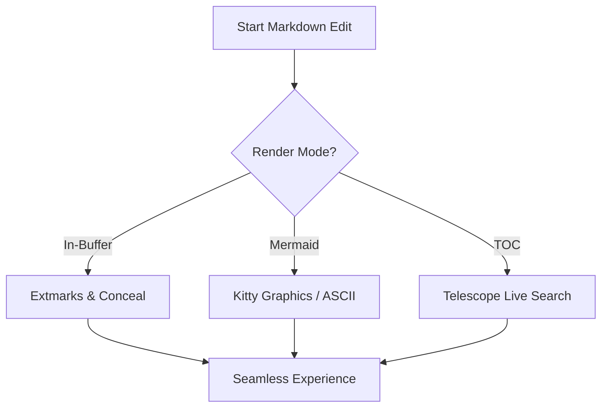

# SuperMarkdown Showcase

Welcome to **super-markdown.nvim**! This document demonstrates all features of the plugin in action.

---

## 1. Checklists & Task Management

Interactive checkboxes that can be toggled using `<leader>mx`:

- [ ] Unchecked task (press `<leader>mx` to check)
- [x] Completed task with green checkmark
- [-] Canceled or postponed task
- [/] Task currently in progress
- [!] Urgent / high-priority item
- [?] Open question needing investigation

---

## 2. GitHub & Obsidian Callouts

> [!NOTE]
> This is an informative callout note. Notice the styled vertical bar and icon.

> [!TIP]
> You can preview any Mermaid diagram by placing your cursor inside the block and pressing `<leader>mp`.

> [!IMPORTANT]
> The TOC viewer seamlessly integrates with Telescope or Snacks to let you jump anywhere instantly.

> [!WARNING]
> In-buffer rendering makes reading documents a joy without needing an external browser!

> [!CAUTION]
> Always verify database migrations before running them in production environments.

> [!TODO]
> Implement automatic image paste directly from system clipboard.

---

## 3. Interactive Tables

Press `<leader>mtf` inside any table to auto-format and align columns. Press `<Tab>` and `<S-Tab>` to navigate cells!

| Feature                       |   SuperMarkdown    | render-markdown | markdown-preview |
| :---------------------------- | :----------------: | :-------------: | :--------------- |
| **In-buffer live rendering**  |       ✅ Yes       |     ✅ Yes      | ❌ Browser only  |
| **Mermaid diagram rendering** | ✅ Kitty/ASCII/Web |      ❌ No      | ⚠️ Browser only  |
| **Telescope TOC Search**      |       ✅ Yes       |      ❌ No      | ❌ No            |
| **Table formatting & <Tab>**  |    ✅ Built-in     |      ❌ No      | ❌ No            |
| **Smart list continuation**   |    ✅ Built-in     |      ❌ No      | ❌ No            |

---

## 4. Mermaid Diagram Architecture

Place your cursor on the diagram below and run `:SuperMarkdown mermaid` (or press `<leader>mp`):



Another sequence diagram example:

```mermaid
sequenceDiagram
autonumber
    actor User as User (Neovim)
    participant SM as super-markdown.nvim
    participant Term as Terminal / Kitty
    User->>SM: Press <leader>mp on block
    SM->>SM: Hash & Check Cache
    SM->>Term: Stream Kitty Graphics / icat
    Term-->>User: Render Diagram in Float Window
    Term -- >> SM: testing 
```

---

## 5. Code Blocks with Badges

### Lua Configuration Snippet

```lua
local super_markdown = require("super-markdown")

super_markdown.setup({
  render = {
    enabled = true,
  },
  mermaid = {
    theme = "dark",
  },
})
```

### Python Snippets

```python
from dataclasses import dataclass
from typing import List, Optional


@dataclass
class TaskMetric:
    name: str
    duration_ms: float
    completed: bool = True

    def throughput(self, batch_size: int = 100) -> float:
        """Calculates items processed per second."""
        if self.duration_ms <= 0:
            raise ValueError("duration_ms must be positive")
        return (batch_size / self.duration_ms) * 1000.0


def summarize_metrics(metrics: List[TaskMetric]) -> Optional[str]:
    active = [m for m in metrics if m.completed]
    if not active:
        return None
    avg_tp = sum(m.throughput() for m in active) / len(active)
    return f"Processed {len(active)} tasks (avg: {avg_tp:.2f} ops/sec)"
```

### Java Snippets

```java
package dev.supermarkdown.showcase;

import java.time.Duration;
import java.util.List;
import java.util.stream.Collectors;

public record RenderJob(String documentId, int lineCount, Duration elapsed) {

    public double linesPerSecond() {
        long millis = Math.max(1L, elapsed.toMillis());
        return (lineCount * 1000.0) / millis;
    }

    public static List<String> formatReport(List<RenderJob> jobs) {
        return jobs.stream()
                .filter(job -> job.lineCount() > 0)
                .map(job -> String.format(
                        "[%s] %d lines rendered in %d ms (%.1f lines/sec)",
                        job.documentId(),
                        job.lineCount(),
                        job.elapsed().toMillis(),
                        job.linesPerSecond()))
                .collect(Collectors.toList());
    }
}
```

---

## 6. Links and References

- Visit the [Official Neovim Documentation](https://neovim.io)
- Explore the [Kitty Terminal Graphics Protocol](https://sw.kovidgoyal.net/kitty/graphics-protocol/)
- Check out [super-markdown.nvim Specification](./SPEC.md)
