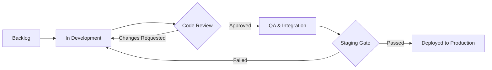

# Q4 Sprint 42 - Execution Backlog

> **Sprint Duration**: Oct 14 - Oct 28, 2026
> **Team Velocity Goal**: 45 Story Points
> **Scrum Master**: Alex Chen

---

## 1. Sprint Objectives

The primary focus for Sprint 42 is completing the database sharding migration and stabilizing terminal graphics protocols for our desktop client.

> [!WARNING]
> Database cutover is scheduled for Saturday at 02:00 UTC. All non-essential cron jobs must be paused beforehand.

> [!CAUTION]
> Do not execute manual schema alterations without coordinating with the DBA team.

---

## 2. Release Lifecycle State Machine

The following lifecycle governs task transitions across the sprint:



---

## 3. Sprint Epics & Breakdown

### 3.1 Epic: Terminal Graphics Protocol Support (SP: 18)

#### Core Protocol Integration
- [x] Investigate Kitty Graphics Protocol specification and escape format
- [x] Implement base64 chunked escape code streaming
- [/] Add fallback support for Sixel graphics on legacy terminals
- [-] Deprecate Überzug backend due to window redraw flickering
- [!] Fix segfault on oversized PNG rendering in Kitty

#### User Experience Enhancements
- [x] Floating popup window with auto-centering
- [ ] Add zoom in / zoom out controls (`+` / `-`) inside floating preview
- [?] Should we allow user-customized popup border styles?

### 3.2 Epic: Storage Sharding & Read Replicas (SP: 21)

#### Database Migration
- [x] Provision read replica in `us-east-2`
- [/] Rebalance tenant shards 001 through 064
- [ ] Implement query router connection pooling in Go
- [!] Run synthetic load test at 50,000 requests/second

---

## 4. Work Allocation & Capacity Table

| Engineer | Assigned Epic | Points | Target Delivery | Status |
| :--- | :--- | :---: | :---: | ---: |
| Sarah Connor | Terminal Protocol | 10 | Oct 22 | On Track |
| Miles Dyson | Storage Sharding | 13 | Oct 24 | In Progress |
| John Doe | QA & Load Testing | 8 | Oct 26 | Pending |
| Jane Smith | Docs & Release Notes | 6 | Oct 27 | Not Started |

---

## 5. Deployment Script

```bash
#!/usr/bin/env bash
set -euo pipefail

echo "Deploying Sprint 42 artifact..."
kubectl apply -f k8s/production-deployment.yaml
kubectl rollout status deployment/gateway-service --timeout=120s
echo "Deployment completed successfully!"
```

---

## 6. Retrospective Notes

> [!TIP]
> Use the sidebar outline (`<leader>ms`) to quickly navigate between epics during standup meetings.
