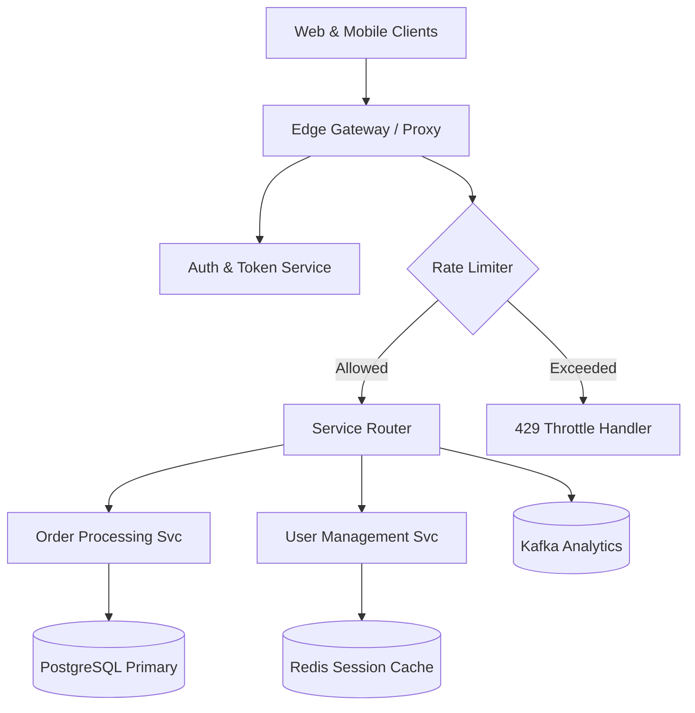
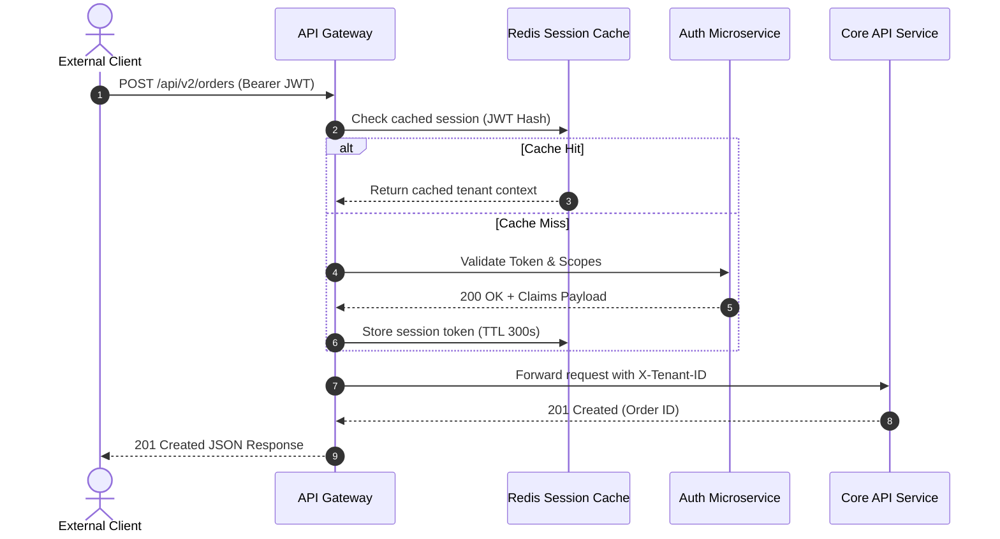

# Distributed Gateway Architecture Spec

> **Document Status**: `APPROVED`
> **Version**: 2.4.0
> **Target Release**: Q4 2026

---

## 1. Overview & System Goals

The Distributed Gateway handles high-throughput API routing, TLS termination, token verification, and real-time observability across all backend microservices.

> [!NOTE]
> All external client requests must pass through the edge proxy layer before accessing internal network services.

> [!IMPORTANT]
> Rate limits are enforced on a per-tenant token bucket basis. Exceeding limits triggers an immediate `429 Too Many Requests` response.

```bash ls dir 

```
```
```
```
```

---

## 2. Microservice Topology

The following diagram outlines the edge proxy and internal service communication topology:



> [!TIP]
> Hover cursor over the diagram above and press `<leader>mp` to view the high-resolution rendered diagram or toggle ASCII mode!

---

## 3. Authentication & Handshake Flow

Every incoming request negotiates JWT verification through the sequence described below:



---

## 4. Gateway Routing Table

Below is the active routing manifest with target destinations, protocols, and latency SLOs:

| Endpoint Route | Target Cluster | Protocol | Timeout | SLO Latency |
| :--- | :--- | :---: | :---: | ---: |
| `/api/v2/auth/*` | auth-cluster.internal | gRPC | 1500ms | < 25ms |
| `/api/v2/users/*` | users-cluster.internal | HTTP/2 | 3000ms | < 40ms |
| `/api/v2/orders/*` | orders-cluster.internal | HTTP/2 | 5000ms | < 80ms |
| `/ws/telemetry` | stream-cluster.internal | WebSocket | 0ms | < 10ms |

---

## 5. Security Checklist

- [x] Configure mTLS between Edge Gateway and internal services
- [x] Implement SHA-256 HMAC request signature verification
- [/] Roll out automated secret rotation with Vault
- [ ] Conduct third-party penetration testing on `/ws/telemetry`
- [!] Patch OpenSSL vulnerability CVE-2026-9921 on production edge nodes
- [?] Determine whether WebSocket connections require ticket refresh tokens

---

## 6. Implementation Sample

The core routing middleware is configured as follows:

```bash 


```

```lua
local gateway = require("gateway.router")

gateway.register({
  route = "/api/v2/orders",
  handler = function(req, res)
    local claims = req.context.claims
    if not claims or not claims.tenant_id then
      return res:status(401):json({ error = "Unauthorized access" })
    end
    return res:proxy_pass("http://orders-cluster.internal:8080")
  end,
})
```

---

## 7. Related References

- [API Reference Guide](./api_reference.md)
- [Sprint Backlog](./sprint_backlog.md)
- [Architecture RFC Document](https://github.com/example/rfc-gateway)
